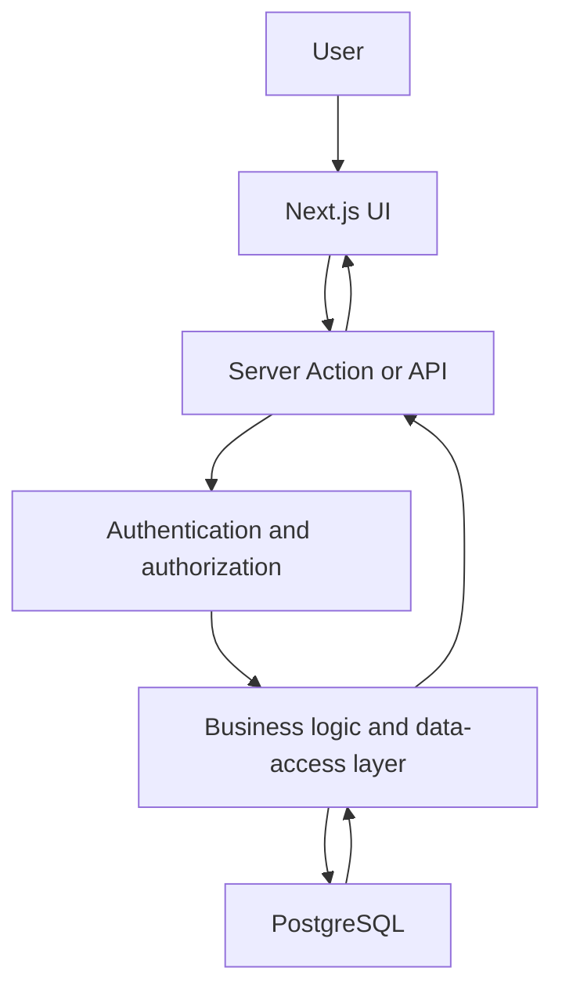
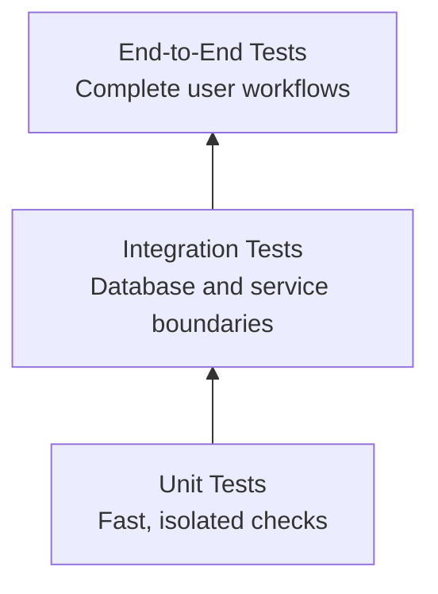
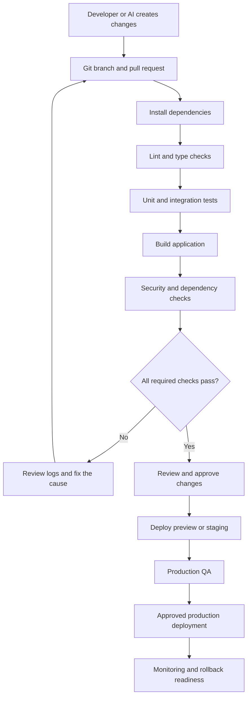

# Vibe Coding: A Complete Beginner-to-Production Guide

### From Idea → Planning → AI-Assisted Development → Testing → Deployment → Production

**Audience:** Beginners, developers adopting AI coding agents, and solo builders

**Tools covered:** Cursor, Claude Code, GitHub Copilot, Ollama, Git, GitHub, automated testing and CI/CD

**Core principle:** Describe the intended outcome, give the AI reliable project context, constrain its changes, and independently verify the resulting software.

---

## Table of Contents

1. [Phase 1: The Concept - Zero to Vibe](#phase-1-the-concept--zero-to-vibe)
2. [Phase 2: Environment and Tooling Setup](#phase-2-environment-and-tooling-setup)
3. [Phase 3: The Core Workflow - Iterative Generation](#phase-3-the-core-workflow--iterative-generation)
4. [Phase 4: Production-Ready Vibe Coding](#phase-4-production-ready-vibe-coding)
5. [Complete Project Checklist](#complete-project-checklist)
6. [Glossary](#glossary)

---

# Phase 1: The Concept - Zero to Vibe

## 1.1 What Is Vibe Coding?

Vibe coding is an AI-assisted software development approach in which a developer expresses requirements in natural language and uses AI tools to generate, modify, explain, and test code.

Instead of manually writing every line, the developer increasingly focuses on:

- **Intent:** What should the software accomplish?
- **Context:** What does the AI need to understand about the repository and requirements?
- **Architecture:** How should the components and data flow fit together?
- **Constraints:** What must not change, and what rules must the implementation follow?
- **Verification:** How can we prove the implementation behaves correctly?

Vibe coding can accelerate development, but it does not remove the need to understand the system being built.

> **Engineering principle:** Natural language specifies the intent. Architecture constrains the solution. Tests and reviews provide evidence that the solution works.

### Vibe Coding vs. Traditional Coding

```mermaid
flowchart TB
    subgraph traditional["Traditional Coding Workflow"]
        A1["Requirements"] --> A2["Developer designs solution"]
        A2 --> A3["Developer writes code"]
        A3 --> A4["Run and debug"]
        A4 --> A5["Test and review"]
        A5 --> A6{"Passes?"}
        A6 -- No --> A3
        A6 -- Yes --> A7["Deploy"]
    end

    subgraph vibe["AI-Assisted Vibe Coding Workflow"]
        B1["Natural-language intent"] --> B2["Requirements and context"]
        B2 --> B3["AI proposes a plan"]
        B3 --> B4["Human reviews the plan"]
        B4 --> B5["AI generates bounded changes"]
        B5 --> B6["Run tests and inspect diffs"]
        B6 --> B7{"Verified?"}
        B7 -- No --> B8["Evidence-based correction"]
        B8 --> B5
        B7 -- Yes --> B9["Review, merge and deploy"]
    end

    classDef traditionalStyle fill:#1e293b,color:#f8fafc,stroke:#64748b
    classDef vibeStyle fill:#102a43,color:#f8fafc,stroke:#38bdf8
    class A1,A2,A3,A4,A5,A6,A7 traditionalStyle
    class B1,B2,B3,B4,B5,B6,B7,B8,B9 vibeStyle
```



**How to interpret the diagram**

Traditional development often places more direct responsibility for implementation on the developer. AI-assisted development delegates more implementation work to an agent while the developer maintains control of requirements, architecture, changes, and verification.

The two workflows are not mutually exclusive. Professional AI-assisted development still uses conventional engineering methods.

> 🖼️ **Visual Reference:** Reproduce the uploaded reference's dark, three-column coding workspace: a left sidebar for workflow phases, a central panel for the current task and generated code, and a right panel for project files. Use distinct colors for planning, implementation, testing, security, deployment, and iteration.

## 1.2 Understand the Developer's New Responsibilities

AI coding tools can generate code quickly, but they may misunderstand requirements, introduce unnecessary dependencies, overlook authorization checks, or modify unrelated files.

The developer remains responsible for:

| Responsibility | What it means |
|---|---|
| Product thinking | Define the problem, users, and expected outcomes. |
| Context management | Supply accurate requirements and relevant repository information. |
| Architecture | Define component boundaries, data flow, and security boundaries. |
| Task orchestration | Break complex work into reviewable changes. |
| Quality assurance | Verify functionality, edge cases, and regressions. |
| Security | Review access control, secrets, dependencies, and data handling. |
| Release management | Control deployment, monitoring, recovery, and rollback. |

## 1.3 Understand the Complete Workflow

```text
IDEA
  ↓
RESEARCH
  ↓
DEFINE USERS AND PROBLEM
  ↓
PRODUCT REQUIREMENTS (PRD)
  ↓
SELECT TECHNOLOGY STACK
  ↓
ARCHITECTURE AND DESIGN
  ↓
PROJECT RULES AND TASKS
  ↓
ENVIRONMENT SETUP
  ↓
ITERATIVE IMPLEMENTATION
  ↓
AUTOMATED AND MANUAL TESTING
  ↓
SECURITY AND CODE REVIEW
  ↓
PREVIEW DEPLOYMENT
  ↓
PRODUCTION QA
  ↓
PRODUCTION RELEASE
  ↓
MONITORING AND RECOVERY
  ↓
ITERATION
```

Never treat this as a guaranteed linear process. Requirements, implementation, and tests may need to be revisited as new information emerges.

---

# Phase 2: Environment and Tooling Setup

## 2.1 Choose Your AI Coding Tool

Different tools suit different development environments. Features, pricing, model availability, and supported integrations change over time; verify the current official documentation before installing or subscribing.

| Tool | Typical workflow | Best starting point |
|---|---|---|
| Cursor | AI-assisted IDE and repository editing | Developers who prefer a visual editor |
| Claude Code | Terminal-based coding agent | Developers comfortable with command-line workflows |
| GitHub Copilot | IDE assistance, chat, and supported agent workflows | Developers working in GitHub-oriented environments |
| Ollama | Local model runtime | Experimenting with local AI models |
| Replit | Browser-based development | Quick prototypes with minimal local setup |
| Lovable | AI-assisted UI and web application creation | UI-focused prototypes |
| Bolt | Browser-based application generation | Rapid web application experiments |

These tools are not interchangeable in every situation. Select a primary coding environment first, then add integrations when they solve a real problem.

### Recommended beginner stack

The following is an example stack based on the uploaded reference.

| Layer | Example choice |
|---|---|
| AI coding environment | Cursor |
| Frontend | Next.js |
| Language | TypeScript |
| Styling | Tailwind CSS |
| Database | PostgreSQL through Supabase |
| Authentication | Supabase Auth |
| Version control | Git and GitHub |
| End-to-end tests | Playwright |
| Hosting | Vercel |
| CI/CD | GitHub Actions |

This is a practical example, not a universal requirement. A Flask application, a vanilla JavaScript project, or a local Python utility may need a very different stack.

## 2.2 Install the Local Development Environment

For the example Next.js stack, install:

1. Cursor or VS Code.
2. Git.
3. A supported Node.js LTS release.
4. npm, included with Node.js.
5. A GitHub account.
6. A modern browser.

Optional tools include Docker, GitHub CLI, a database client, and an API testing application such as Bruno or Postman.

Verify the installation:

```bash
node --version
npm --version
git --version
```

Create the project directory:

```bash
mkdir student-dashboard
cd student-dashboard
git init
```

For an existing repository, clone it instead:

```bash
git clone <YOUR_REPOSITORY_URL>
cd <YOUR_PROJECT_DIRECTORY>
```

Do not initialize a second Git repository inside an existing repository unless that is intentional.

## 2.3 Install and Start a Next.js Example

For a new project, use the official project scaffolding tool:

```bash
npx create-next-app@latest student-dashboard
cd student-dashboard
npm run dev
```

Follow the interactive setup prompts and confirm the options match the chosen stack. Open the local URL printed in the terminal.

Before asking the AI to implement features:

1. Confirm the application starts.
2. Inspect the generated files.
3. Read the package scripts.
4. Commit or otherwise preserve the initial working state.
5. Confirm the project builds before making substantial changes.

**For a Python or Flask project:** use the appropriate Python interpreter, virtual environment, dependency manager, and framework setup instead. Do not force a JavaScript stack onto an unrelated project.

## 2.4 Install Claude Code or Configure an IDE Agent

Use the official documentation for installation and authentication:

- Cursor: https://docs.cursor.com/
- Claude Code: https://docs.anthropic.com/en/docs/claude-code/overview
- GitHub Copilot: https://docs.github.com/en/copilot
- Ollama: https://docs.ollama.com/

For Claude Code, follow the official installation instructions for your operating system, install the supported CLI, authenticate using the documented method, and run it from the repository directory.

Before allowing an agent to make changes, understand its file access, shell command permissions, approval controls, and any connected tools.

For GitHub Copilot, enable the supported features in your IDE and review the repository's instructions and agent capabilities.

Do not assume every feature is included in every plan or IDE integration.

## 2.5 Optional: Run a Local Model with Ollama

Ollama lets you run supported language models locally. This can be useful for learning, experimentation, and some coding assistance workflows.

Official model and installation documentation: https://docs.ollama.com/

After installing Ollama, choose a model that fits your hardware and the tasks you want to perform.

For example:

```bash
ollama --version
ollama pull <MODEL_NAME>
ollama run <MODEL_NAME>
```

Replace `<MODEL_NAME>` with an actual model available in the Ollama library.

### Important local-model considerations

- RAM and available VRAM constrain the models you can run effectively.
- Quantized smaller models may be more practical on limited hardware.
- Local inference can be slower or less capable than a suitable hosted model.
- Local execution does not guarantee that prompts or files remain private if additional integrations transmit data elsewhere.
- Ollama is a model runtime, not a complete coding-agent workflow by itself.

To connect a local model to an IDE or agent, verify that the specific integration supports the required provider, API format, model capabilities, and tool calling. Do not assume any model can replace every hosted coding agent.

## 2.6 Establish Git and GitHub from the Beginning

AI-generated changes can break previously working functionality. Version control gives you a reviewable history and a recovery path.

```bash
git status
git add .
git commit -m "chore: establish initial project"
```

After configuring a GitHub remote:

```bash
git remote add origin <YOUR_REPOSITORY_URL>
git push -u origin <YOUR_BRANCH>
```

Only add the remote if one does not already exist.

Use Git to:

- Review changes before accepting them.
- Compare working and previous versions.
- Create feature branches.
- Revert unwanted changes safely.
- Review AI-generated diffs.
- Collaborate through pull requests.

Do not assume that a Git commit is a backup of external databases, uploaded files, production secrets, or other state outside the repository.

## 2.7 Configure Persistent AI Rules

An AI coding agent needs more than the latest chat message. It needs persistent project rules and relevant context.

### Recommended project structure

```text
student-dashboard/
├── .cursor/
│   └── rules/
│       ├── general.mdc
│       ├── frontend.mdc
│       ├── backend.mdc
│       └── testing.mdc
├── docs/
│   ├── PRD.md
│   ├── ARCHITECTURE.md
│   ├── DESIGN.md
│   ├── TEST_PLAN.md
│   ├── SECURITY.md
│   ├── DECISIONS.md
│   └── MEMORY.md
├── src/
├── tests/
├── .env.example
├── .gitignore
├── README.md
├── RULES.md
└── TASKS.md
```

This is an illustrative structure. Not every project needs every file or directory.

### What belongs in each file?

| File | Responsibility |
|---|---|
| `PRD.md` | What the product must accomplish and why |
| `ARCHITECTURE.md` | System boundaries, components, data flow, and dependencies |
| `DESIGN.md` | Visual design, reusable components, and interaction rules |
| `RULES.md` | General engineering standards for AI-assisted work |
| `TASKS.md` | Prioritized tasks, dependencies, and completion state |
| `TEST_PLAN.md` | Test scenarios and acceptance criteria |
| `SECURITY.md` | Security requirements, threats, and controls |
| `DECISIONS.md` | Important technical decisions and their rationale |
| `MEMORY.md` | Current project state, known issues, and next step |
| `.env.example` | Required environment variable names without real secrets |
| `README.md` | Setup, usage, and contribution instructions |

For a small project, start with a PRD, a rules file, a task list, a README, and a `.gitignore`. Add documentation as complexity increases.

### Cursor rules

Cursor supports project rules under `.cursor/rules/`. Rule formats and configuration options can change, so follow the current official documentation.

Example `.cursor/rules/general.mdc`:

```markdown
---
description: General project engineering rules
alwaysApply: true
---

# Project Engineering Rules

- Read the relevant documentation before modifying code.
- Inspect existing code before introducing new components.
- Follow the documented architecture and design system.
- Make small, focused changes.
- Do not modify unrelated files.
- Do not invent requirements or external API behavior.
- Never expose secrets or credentials.
- Validate input and enforce authorization server-side.
- Add or update tests for meaningful behavior changes.
- Run relevant checks and report actual results.
- Identify unresolved risks and unverified assumptions.
```

Keep general rules concise. Use separate frontend, backend, security, or testing rules when the repository requires different instructions for different file types.

### What about `.cursorrules`?

Older projects may use a root-level `.cursorrules` file. For a new Cursor project, prefer the currently documented `.cursor/rules/` approach unless your installed version or existing repository requires otherwise.

Do not maintain contradictory instructions in several places. If both old and new rule formats are present, determine which ones the installed tool actually reads.

### Claude Code instructions

Claude Code commonly uses a repository-level `CLAUDE.md` file for project instructions, with additional supported instruction mechanisms available in its documentation.

Example:

```markdown
# Project Instructions

Read these files before implementation:

- docs/PRD.md
- docs/ARCHITECTURE.md
- docs/DESIGN.md
- RULES.md
- TASKS.md

Before editing:
1. Inspect the existing implementation.
2. Identify the smallest coherent change.
3. Explain the plan for non-trivial tasks.
4. Identify security and regression risks.

After editing:
1. Run the relevant tests and checks.
2. Review the final diff.
3. Report changed files and actual test results.
4. Update project documentation when needed.
```

### GitHub Copilot instructions

GitHub Copilot supports repository-level instruction mechanisms, including `.github/copilot-instructions.md` in supported workflows. Check the official documentation for your IDE and feature.

The principle is the same: provide durable repository context in the format the selected tool actually recognizes.

## 2.8 Manage Context Windows Effectively

A context window is the amount of information a model can process during a particular interaction. Exact capacity depends on the model and product configuration.

Do not rely on the model remembering every earlier decision in a long conversation.

Use this hierarchy:

1. **Project rules:** Durable coding and security standards.
2. **Requirements:** The product behavior that must be implemented.
3. **Architecture:** System boundaries and technical decisions.
4. **Task context:** Files and behavior relevant to the current task.
5. **Recent evidence:** Test output, error messages, and observed behavior.
6. **Current plan:** What the agent should do next.

For each task, provide relevant file paths and ask the agent to inspect the repository rather than pasting every source file into the prompt.

Maintain `MEMORY.md` for concise project state:

```markdown
# Current Project State

## Completed
- Initial application setup
- Git repository configured
- Base dashboard created

## Current Task
- Implement note creation

## Known Issues
- Note persistence has not been implemented

## Important Decisions
- Database operations must remain server-side
- Authorization must be verified for each user-owned record

## Next Step
- Implement note creation with validation and tests
```

Update this document when the state changes materially. It should summarize current facts, not duplicate the entire project history.

---

# Phase 3: The Core Workflow - Iterative Generation

## 3.1 Define the Product Before Asking AI to Build It

Use the StudentHub example from the reference file.

### Step 1: Identify the problem

College students need a centralized place to organize academic notes, assignments, and deadlines.

### Step 2: Identify the users

- BCA students
- BSc Computer Science students
- BTech students

### Step 3: Define the MVP

The Minimum Viable Product should deliver the smallest coherent set of features that solves the core problem.

**Initial scope**

- Signup and login
- Dashboard
- Create, edit, and delete notes
- Create assignments
- Mark assignments complete
- Manage deadlines

**Out of scope**

- Payments
- Social feed
- Gamification
- AI tutor
- Separate mobile application

An explicit out-of-scope list helps prevent an AI agent from continuously expanding the application beyond its purpose.

## 3.2 Create the PRD

Create `docs/PRD.md`:

```markdown
# Product Requirements Document

## Product
StudentHub

## Problem
Students struggle to manage academic notes,
assignments, and deadlines.

## Target Users
BCA, BSc CS, and BTech students.

## Goal
Provide a centralized academic productivity dashboard.

## Core Features
1. Authentication
2. Dashboard
3. Notes
4. Assignments
5. Deadlines

## MVP Acceptance Criteria
- Users can create and access their accounts.
- Users can create notes.
- Users can edit and delete their notes.
- Users can create assignments.
- Users can mark assignments complete.
- Users cannot access another user's private records.

## Out of Scope
- Payments
- AI tutor
- Social feed
- Separate mobile application

## Success Criteria
A user can complete the core academic workflow
without encountering data leakage or broken navigation.
```

The PRD defines **what** to build and **why**. It should not dictate every implementation detail unless a technical constraint is necessary.

## 3.3 Define the Architecture

Create `docs/ARCHITECTURE.md`.

For the example stack:

```markdown
# Architecture

## Frontend
Next.js and TypeScript

## Styling
Tailwind CSS

## Server
Next.js server-side functionality

## Database
Supabase PostgreSQL

## Authentication
Supabase Auth

## Deployment
Vercel

## Architectural Rules
- Keep UI and data-access responsibilities separate.
- Validate input at trusted server boundaries.
- Enforce authorization server-side.
- Restrict users to records they are permitted to access.
- Reuse existing components and services.
- Avoid unnecessary dependencies.
```

Example conceptual data flow:



This is a conceptual architecture. The actual implementation must reflect the selected framework's security model and the way Supabase is configured.

## 3.4 Define the Design System

Create `docs/DESIGN.md`.

```markdown
# Design System

## Style
Modern, minimal, professional.

## Typography
Use a consistent, readable type scale.

## Colors
Primary: #6366F1
Background: #F8FAFC
Text: #0F172A
Muted: #64748B

## Components
- Primary button
- Secondary button
- Destructive button
- Form controls
- Cards
- Dialogs
- Navigation

## UX Requirements
- Responsive layouts
- Visible focus indicators
- Accessible forms
- Loading states
- Empty states
- Error states
- Clear success feedback
```

The exact visual tokens can change to suit the product. The important part is consistency across screens.

> 🖼️ **Visual Reference:** Use a dark IDE-style layout similar to the uploaded screenshot for the workflow documentation itself: a narrow colored phase sidebar, a central task/code panel, and a project-file tree on the right. For the example StudentHub product, define a separate end-user design system rather than automatically copying the IDE aesthetic into the application.

## 3.5 Build a Task Breakdown

Create `TASKS.md`:

```markdown
# Implementation Tasks

## Phase 1: Setup
- [ ] Initialize project
- [ ] Configure TypeScript
- [ ] Configure styling
- [ ] Configure Git
- [ ] Confirm local development works

## Phase 2: Authentication
- [ ] Create signup page
- [ ] Create login page
- [ ] Configure authentication
- [ ] Protect private pages
- [ ] Verify server-side authorization
- [ ] Test authentication flows

## Phase 3: Notes
- [ ] Define notes data model
- [ ] Implement data-access functions
- [ ] Implement note creation
- [ ] Implement note listing
- [ ] Implement editing
- [ ] Implement deletion
- [ ] Verify ownership enforcement
- [ ] Add automated tests

## Phase 4: Assignments
- [ ] Define assignment data model
- [ ] Implement assignment creation
- [ ] Implement completion status
- [ ] Add validation and tests

## Phase 5: Release
- [ ] Review security
- [ ] Run automated checks
- [ ] Deploy a preview
- [ ] Complete production QA
```

Keep tasks small enough that the changes can be reviewed and tested without needing to understand a large, unrelated diff.

## 3.6 The Context → Intent → Constraints Prompt Framework

An effective meta-prompt describes the repository context, the desired outcome, and the boundaries within which the AI must work.

### Context

Explain what already exists.

Include:

- Product and feature purpose
- Relevant documentation
- Existing implementation and file paths
- Framework and dependencies
- Current state and observed issues

### Intent

Specify the outcome.

Include:

- The feature or problem
- Expected behavior
- Acceptance criteria
- Required error handling
- Required test scenarios

### Constraints

Specify boundaries.

Include:

- Files that may or may not change
- Architecture and design rules
- Security requirements
- Dependency restrictions
- Performance or compatibility requirements
- Tests that must pass

A useful prompt also specifies how the agent should report its results.

### Reusable implementation prompt

```markdown
# Task: Implement One Feature

## Context
Read the relevant requirements and project instructions.
Inspect the existing repository before making changes.

Project:
StudentHub

Feature:
[ONE SPECIFIC FEATURE]

Relevant Files:
[RELEVANT PATHS, IF KNOWN]

## Intent
Implement the feature so that:

1. [EXPECTED BEHAVIOR]
2. [EXPECTED BEHAVIOR]
3. [EXPECTED BEHAVIOR]

Acceptance Criteria:
- Valid inputs behave correctly.
- Invalid inputs produce appropriate errors.
- Required data persists correctly.
- Unauthorized access is denied.
- Relevant tests cover success and failure cases.

## Constraints
- Follow the project architecture and design system.
- Reuse existing components and services.
- Do not modify unrelated files.
- Do not add dependencies without justification.
- Do not invent requirements.
- Do not expose secrets.
- Enforce authorization server-side.

## Workflow
1. Inspect the relevant implementation.
2. Summarize the current state.
3. Propose a small implementation plan.
4. Identify risks and affected files.
5. Wait for approval if the change is broad or high-risk.
6. Implement the smallest coherent change.
7. Run the relevant tests and checks.
8. Review the final diff.

## Report
List:
- Files changed
- Behavior implemented
- Tests actually executed
- Test results
- Known limitations
- Remaining risks
```

## 3.7 Plan Before Editing

For non-trivial changes, start with a planning-only prompt.

```markdown
Read PRD.md, ARCHITECTURE.md, DESIGN.md,
RULES.md, and TASKS.md.

Inspect the existing repository.

Do not edit files or install dependencies yet.

Return:
1. Your understanding of the requirement.
2. Existing components that can be reused.
3. Files likely to require changes.
4. A small, ordered implementation plan.
5. Security and regression risks.
6. Tests required to verify the change.
7. Missing information or assumptions.

Wait for approval before implementing.
```

This separates planning from execution and gives the developer a chance to correct a misunderstanding before it spreads across multiple files.

## 3.8 Implement Vertical Slices

Avoid building the entire frontend first and the entire backend afterward.

Instead, implement complete user-facing flows.

For note creation:

1. Create the note form.
2. Validate its inputs.
3. Submit the data through a trusted server boundary.
4. Persist the note.
5. Display the saved note.
6. Handle loading, success, and failure states.
7. Verify the user owns the note.
8. Test the complete flow.

A vertical slice gives you a working, testable increment.

### Example UI and agent workspace

```text
┌───────────────────┬────────────────────────────┬──────────────────┐
│ VIBE CODING       │ CURRENT TASK               │ PROJECT FILES    │
│ WORKFLOW          │                            │                  │
│                   │ Implement note creation    │ docs/            │
│ 01 Product        │                            │ ├─ PRD.md        │
│ 02 Research       │ Context                    │ ├─ DESIGN.md     │
│ 03 Architecture   │ StudentHub MVP             │ ├─ RULES.md      │
│ 04 Design         │                            │ └─ TASKS.md      │
│ 05 Rules          │ Intent                     │ src/             │
│ 06 Tasks          │ Persist a new note safely  │ tests/           │
│ 07 Development    │                            │                  │
│ 08 Testing        │ Constraints                │ Changed files    │
│ 09 Security       │ Validate and authorize     │ Test results     │
│ 10 Deployment     │                            │ Git diff         │
│                   │ Plan → Edit → Test         │                  │
└───────────────────┴────────────────────────────┴──────────────────┘
```

> 🖼️ **Visual Reference:** This wireframe maps the uploaded image's workflow sidebar, central AI coding area, and project-file panel into a tool-independent layout. It is a conceptual guide, not an exact reproduction of a specific IDE.

## 3.9 Handle Hallucinations and Unsupported Claims

AI-generated output can contain incorrect API names, nonexistent functions, outdated dependencies, unsupported framework features, or fabricated explanations.

Use evidence rather than accepting plausible language.

### Verification procedure

1. Identify the specific claim or code path.
2. Inspect the relevant source files and dependency versions.
3. Consult official documentation.
4. Reproduce the behavior locally.
5. Run the smallest relevant test.
6. Review the diff and resulting behavior.
7. Record any unresolved uncertainty.

Ask the AI:

```markdown
For each important technical claim:

- Identify the relevant source file or official documentation.
- Distinguish verified facts from assumptions.
- Do not invent API methods or package options.
- Check the installed dependency version.
- If evidence is missing, say so explicitly.
- Propose a minimal verification step.
```

A citation or confident explanation is not proof that code works. The actual environment and test results matter.

## 3.10 Debug AI-Generated Code Systematically

Do not ask an agent to randomly rewrite a feature because it failed.

Provide:

- The actual error output
- Expected behavior
- Observed behavior
- Minimal reproduction steps
- Relevant code and configuration
- Recent changes
- Constraints on the fix

### Root-cause debugging prompt

```markdown
Investigate this issue without editing files initially.

## Error
[ACTUAL ERROR MESSAGE]

## Expected Behavior
[WHAT SHOULD HAPPEN]

## Observed Behavior
[WHAT ACTUALLY HAPPENS]

## Reproduction Steps
[STEPS TO REPRODUCE]

## Evidence
[LOGS, TEST RESULTS, OR RELEVANT FILES]

## Constraints
Do not refactor unrelated components.
Do not change the public API unless necessary.
Do not hide the error without fixing its cause.

First:
1. Trace the failing behavior.
2. Identify the likely root cause.
3. Support the diagnosis with evidence.
4. Propose the smallest appropriate fix.
5. Explain the verification plan.

Wait for approval before editing if the change is
broad, destructive, or security-sensitive.
```

After implementing the fix, rerun the test that exposed the defect and the relevant regression tests.

## 3.11 Orchestrate Multi-File Changes Safely

Multi-file changes are often necessary, but broad changes increase the chance of inconsistent assumptions and regressions.

Use this process:

1. Inspect all affected files.
2. Map dependencies and data flow.
3. Define a clear task boundary.
4. Identify required interface or schema changes.
5. Implement in a deliberate order.
6. Test the affected integration points.
7. Review the complete diff.
8. Update documentation and tests.
9. Commit only after verification.

For a database schema change, for example, inspect the schema, data-access code, validation, API routes, UI, tests, migration process, and rollback implications before editing.

### Multi-file planning prompt

```markdown
Plan the implementation of [FEATURE].

Before editing:

- Identify all affected files and modules.
- Map dependencies between them.
- Identify shared interfaces and data contracts.
- Check database migration requirements.
- Identify security and backward-compatibility risks.
- Define the implementation order.
- Define the tests for each boundary.

Do not edit files until the plan is reviewed.
Avoid unrelated refactoring.
```

## 3.12 Use Git as a Change-Control Mechanism

Before a significant AI-generated change:

```bash
git status
git diff
```

After implementation, inspect the complete diff and run relevant tests.

```bash
git diff --check
git diff
```

If the change is verified:

```bash
git add <RELEVANT_PATHS>
git commit -m "feat: add note creation"
```

Use feature branches and pull requests for larger projects. Do not blindly commit every AI-generated change, and do not discard existing user changes when resetting a failed implementation.

---

# Phase 4: Production-Ready Vibe Coding

## 4.1 Prototype Is Not Production

A prototype demonstrates that an idea can work. A production application must work reliably for real users under expected operating conditions.

| Prototype | Production application |
|---|---|
| Demonstrates a concept | Meets documented acceptance criteria |
| May use temporary data | Has deliberate data persistence and lifecycle management |
| Often has minimal error handling | Handles expected failure modes |
| May have incomplete access controls | Enforces authentication and authorization |
| Manual verification | Repeatable automated tests and release checks |
| Minimal observability | Appropriate logs, alerts, and performance monitoring |
| May lack recovery procedures | Has backup, restore, and rollback plans appropriate to its risks |

Do not claim production readiness simply because the UI looks complete or the application starts locally.

## 4.2 Write Acceptance Criteria Before Implementation

Every feature should have observable outcomes.

For note creation:

- An authenticated user can create a valid note.
- Invalid input is rejected appropriately.
- The saved note remains available after refresh.
- One user cannot read or modify another user's private notes.
- Database failures produce appropriate error handling.
- Tests cover the normal path and important failure cases.

Acceptance criteria help both the AI agent and the developer determine when a feature is complete.

## 4.3 Ask AI to Design Tests Before Implementation

Test-first AI-assisted development means specifying behavior and designing tests before generating the implementation. Depending on the project, you may use test-driven development (TDD), acceptance-test-driven development, or a lighter test-first process.

### Step 1: Specify expected behavior

Write acceptance criteria before code.

### Step 2: Ask for a test plan

```markdown
Read the feature requirements and existing tests.

Do not implement the feature yet.

Produce a test plan containing:

- Normal success cases
- Input validation cases
- Authentication cases
- Authorization and ownership cases
- Empty and boundary conditions
- Database or external-service failures
- Regression risks

Map every test to a specific acceptance criterion.
Identify tests that require mocks, fixtures, or a test database.
```

### Step 3: Generate the tests

Review the tests for correctness and ensure they express the actual requirements.

### Step 4: Run the tests

If the feature does not exist yet, expected failures can confirm that the tests exercise missing behavior. However, failures must be inspected: a test can also fail because of incorrect setup or faulty assumptions.

### Step 5: Implement the feature

Ask the AI to implement only the behavior required to satisfy the approved tests and requirements.

### Step 6: Verify

Run the full relevant test suite and inspect coverage gaps. Passing tests do not prove the absence of all defects.

## 4.4 Build a Testing Pyramid



### Unit tests

Test individual functions, utilities, and components.

### Integration tests

Test interactions between modules, services, and databases.

### End-to-end tests

Test complete user workflows through the actual application interface.

For a web project, Playwright can support browser-based end-to-end tests. Use the official documentation: https://playwright.dev/docs/intro

Example test scenarios for StudentHub:

| Scenario | Expected result |
|---|---|
| Create a valid note | Note is saved and displayed |
| Submit an empty required title | Validation rejects the input |
| Refresh the page | Persisted note remains available |
| Access another user's note | Access is denied |
| Delete a note | Note is removed according to the specified behavior |
| Database operation fails | Application reports a controlled error |

## 4.5 Run Quality Checks

The following are example npm scripts. They must exist in the project's `package.json`.

```bash
npm run lint
npm run typecheck
npm test
npm run build
```

If the project uses different scripts, use the commands defined by that repository.

A successful production build does not prove functional correctness, and a passing unit-test suite does not prove that production authorization is secure.

Report actual command results. Do not allow the AI to claim that tests passed when they were not run.

## 4.6 Perform a Security Review

AI-generated code must be reviewed for security before production.

### Authentication and authorization

- Require authentication where appropriate.
- Enforce authorization on trusted server boundaries.
- Verify ownership of user-specific resources.
- Test attempts to access another user's records.
- Do not rely on hidden UI elements as an access-control mechanism.

### Input validation

- Validate data at appropriate server boundaries.
- Enforce expected types, lengths, formats, and limits.
- Use safe database access patterns.
- Handle malformed requests and unexpected values.

### Secrets and environment variables

Example `.env.example`:

```dotenv
DATABASE_URL=
SUPABASE_URL=
SUPABASE_ANON_KEY=
THIRD_PARTY_API_KEY=
```

Use placeholder values only. Never commit actual credentials.

Keep `.env` and other secret-bearing files out of version control. Verify that public frontend configuration does not expose server-side secrets.

A key described as a publishable or anonymous key is not necessarily a secret, but its permissions and the associated backend policies must still be configured correctly.

### Database security

- Apply appropriate database access policies.
- Verify record ownership on every relevant operation.
- Use migrations for schema changes.
- Review indexes, constraints, and data integrity.
- Test migration and recovery procedures.

### Dependencies

- Avoid unnecessary dependencies.
- Prefer maintained packages from trustworthy sources.
- Review dependency updates and breaking changes.
- Run the package manager's supported audit checks.
- Investigate vulnerabilities instead of blindly applying every suggested fix.

For npm projects, for example:

```bash
npm audit
```

The result requires interpretation. An audit is not a complete security assessment, and automatic dependency upgrades can introduce breaking changes.

### Security review prompt

```markdown
Perform a security review of the current implementation.

Do not modify code initially.

Inspect:
- Authentication and authorization
- User ownership and access-control boundaries
- Input validation
- Database policies and query behavior
- Secret exposure
- Dependency risks
- Error handling and logging
- File uploads, if present
- External API integration
- Sensitive data handling

For every finding, provide:
1. Severity and rationale
2. Affected file or component
3. Evidence and reproduction steps
4. Potential impact
5. Recommended remediation
6. Verification tests

Distinguish confirmed vulnerabilities from potential risks.
Do not claim the application is secure merely because
no issues were found in this review.
```

For a structured baseline, consult the OWASP Top 10: https://owasp.org/www-project-top-ten/

## 4.7 Review Code Quality and Architecture

After implementation, review:

- Separation of concerns
- Reusable components
- Consistent interfaces
- Error handling
- Type safety
- Accessibility
- Performance
- Duplicate logic
- Unnecessary dependencies
- Maintainability

Avoid asking the AI to refactor everything simply because it can.

Prefer small, justified refactors tied to a measurable issue, documented requirement, or demonstrated maintenance problem.

## 4.8 Integrate AI-Assisted Development into CI/CD

Continuous integration (CI) automatically checks changes. Continuous delivery or deployment (CD) automates the process of preparing and releasing changes.

A typical pipeline is:



### Example GitHub Actions workflow

Create `.github/workflows/ci.yml` for a project that defines the required npm scripts.

```yaml
name: CI

on:
  pull_request:
  push:
    branches:
      - main

jobs:
  verify:
    runs-on: ubuntu-latest

    steps:
      - name: Checkout
        uses: actions/checkout@v4

      - name: Set up Node.js
        uses: actions/setup-node@v4
        with:
          node-version: 22
          cache: npm

      - name: Install dependencies
        run: npm ci

      - name: Lint
        run: npm run lint

      - name: Type check
        run: npm run typecheck

      - name: Test
        run: npm test

      - name: Build
        run: npm run build
```

**Before using this example:** confirm the Node.js version matches the project, verify the selected GitHub Actions versions against the current official documentation, and ensure every referenced npm script exists. Projects with integration tests may also need test databases, services, fixtures, and environment configuration.

This workflow verifies code; it does not automatically deploy the application. Add deployment jobs only after defining environment separation, secret handling, permissions, approval gates, and rollback procedures.

### How an AI agent should work with CI

Ask the agent to:

1. Inspect the existing workflow.
2. Identify missing checks.
3. Propose a minimal change.
4. Explain required permissions and secrets.
5. Implement the approved change.
6. Validate YAML syntax and project scripts.
7. Run locally available checks.
8. Review the diff.
9. Report which checks still require execution by GitHub Actions.

Never allow a coding agent to bypass failing required checks simply to make a pull request green.

## 4.9 Deploy Through Preview Before Production

Use this release path:

```text
Local development
      ↓
Pull request and CI
      ↓
Preview deployment
      ↓
Functional and security QA
      ↓
Production approval
      ↓
Production deployment
      ↓
Monitoring and recovery
```

For the example stack, Vercel can provide deployment workflows integrated with GitHub. Confirm the current platform configuration and production deployment behavior in the official documentation.

Before production:

- Configure the correct environment variables.
- Confirm database migrations are safe.
- Verify authentication and authorization.
- Test the live application.
- Check direct routes and page refreshes.
- Verify error handling and data persistence.
- Confirm backups and rollback procedures.
- Ensure monitoring and alerts are available for the application's risk level.

Do not assume local success proves the deployed application is correct.

## 4.10 Monitor and Maintain the Application

Production work continues after release.

Establish appropriate:

- Error reporting
- Application and infrastructure logs
- Availability checks
- Performance monitoring
- Database backups
- Restore testing
- Incident response procedures
- Dependency maintenance
- User feedback collection

Update project documentation whenever important decisions or implementation details change.

Keep `TASKS.md` aligned with the current state. Update `MEMORY.md` with the next task, unresolved issues, and relevant constraints. Record durable architectural decisions in `DECISIONS.md`.

---

# Complete Project Checklist

Use this checklist as the release gate for your AI-assisted project.

## Product and planning

- [ ] Problem and target users are defined.
- [ ] MVP and out-of-scope features are explicit.
- [ ] PRD and acceptance criteria are documented.
- [ ] Architecture and design decisions are documented.
- [ ] Tasks are prioritized and small enough to verify.

## Environment and AI context

- [ ] Development environment works.
- [ ] Git repository is configured.
- [ ] Project rules are in place.
- [ ] Tool-specific AI instructions are configured correctly.
- [ ] Secrets are excluded from version control.
- [ ] AI changes are reviewed before being accepted.

## Implementation and testing

- [ ] Features meet documented acceptance criteria.
- [ ] Error and empty states are handled.
- [ ] Unit tests cover important logic.
- [ ] Integration tests cover important boundaries.
- [ ] End-to-end tests cover critical user flows.
- [ ] Linting and type checks pass where configured.
- [ ] Production build succeeds.
- [ ] Regression tests pass.

## Security and operations

- [ ] Authentication is implemented correctly.
- [ ] Authorization is enforced server-side.
- [ ] User ownership and data isolation are verified.
- [ ] Input validation is in place.
- [ ] Secrets are protected.
- [ ] Dependencies are reviewed.
- [ ] CI checks are configured.
- [ ] Preview deployment has been tested.
- [ ] Production QA is complete.
- [ ] Monitoring and recovery procedures are appropriate.
- [ ] Documentation reflects the released implementation.

> **Release standard:** Mark a check complete only when there is evidence supporting it. A generated checklist, a confident AI report, or a successful build alone is not proof of production readiness.

---

# Glossary

| Term | Meaning |
|---|---|
| Vibe coding | AI-assisted development driven by natural-language intent and iterative verification |
| AI coding agent | A tool that can inspect code and perform supported development tasks |
| Context window | The information a model can process in an interaction |
| Meta-prompt | Instructions that define the task, context, constraints, and expected output |
| PRD | Product Requirements Document |
| MVP | Minimum Viable Product |
| Architecture | The system's components, boundaries, and interactions |
| Vertical slice | A small, complete user-facing feature spanning the necessary application layers |
| Hallucination | A plausible but incorrect or unsupported AI-generated claim |
| CI/CD | Automated integration, verification, and delivery or deployment workflows |
| Regression test | A test that checks existing behavior after a change |
| Rollback | Reverting a release or change to a known-good state |
| Observability | Using logs, metrics, traces, and related evidence to understand system behavior |

---

## Final Principle

**The reliable Vibe Coding loop is:**

**Define intent → Supply context → Plan → Generate → Test → Review → Correct → Commit → Deploy → Monitor.**

AI can accelerate implementation, but production reliability depends on clear requirements, controlled changes, independent verification, security engineering, and operational discipline.
